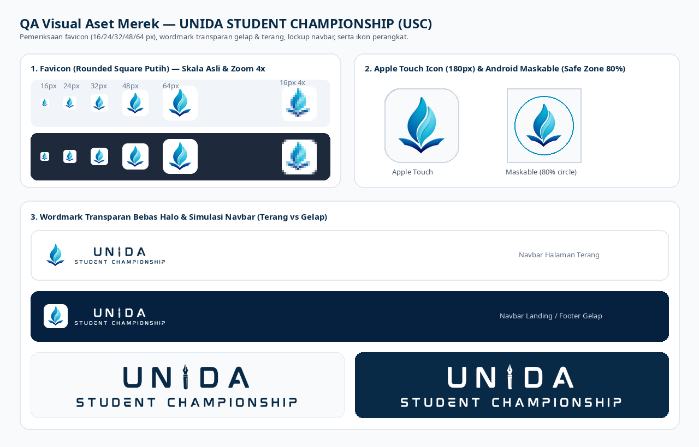

> **Pembaruan visual 24 November 2026 — K-27:** Emblem aktif sekarang adalah [`usc-emblem-blue-master.png`](sources/usc-emblem-blue-master.png), yaitu logo biru–cyan yang diberikan pengguna. Palet UI memakai biru tua `#082A46`, biru utama `#00639C`, dan aksen cyan `#008FC0`. Jalankan `bun run brand:generate` untuk menghasilkan seluruh ukuran. Wordmark USC tetap digunakan. Penjelasan Navy & Gold di bawah merupakan arsip keputusan K-26 sebelum pembaruan ini, bukan spesifikasi warna aktif.

# Identitas Merek UNIDA STUDENT CHAMPIONSHIP (USC) — 24 November 2026

Status: disetujui pemilik produk pada 24 November 2026 (`K-26`), menggantikan identitas aplikasi lama *Simpul Talenta* (`K-24`). Ini adalah identitas aplikasi **UNIDA Student Championship (USC)** dan bukan klaim pengesahan lambang resmi institusi; keputusan institusional `O-05` tetap terbuka.

## Aset Master & Palet Resmi

Sumber master asli (tidak dimodifikasi) disimpan di `docs/design/logo-usc-2026-11/sources/`:
1. **[`usc-emblem-source.png`](sources/usc-emblem-source.png)** (`819 × 1024` px, RGBA transparan): Lambang 3D nyala/daun berwarna Deep Navy & Burnished Gold di atas buku terbuka.
2. **[`usc-wordmark-source.png`](sources/usc-wordmark-source.png)** (`511 × 98` px, berlatar `#F7F7F7`): Wordmark horizontal `UNIDA` (dengan mata pena sebagai huruf `I`) dan `STUDENT CHAMPIONSHIP`.

Palet warna yang diekstrak langsung dari artwork master:
- **Deep Ink Navy (Primer)**: `#142432` (gelap `#142029`)
- **Steel Navy (Sekunder)**: `#1F3442`
- **Burnished Gold (Aksen Utama)**: `#B89669`
- **Warm Gold Highlight**: `#EACA97`

## Strategi Format Optimal

Seluruh turunan diproduksi secara deterministik dari kedua master menggunakan perintah:

```bash
bun run brand:generate
```

Skrip `scripts/generate-brand-assets.ts` menjalankan `scripts/generate-brand-assets.py` (Pillow + NumPy) tanpa panggilan layanan eksternal untuk menghasilkan:

- **Emblem UI (`frontend/public/images/`)**:
  - `usc-emblem.webp` (`~8.7 KB`) & `usc-emblem.png` (`192 × 192` px transparan, padding seimbang) — dipakai di navbar, footer, sidebar admin, dan badge.
  - `usc-emblem-512.webp` (`~27.8 KB`) & `usc-emblem-512.png` (`512 × 512` px transparan) — dipakai di halaman auth dan kebutuhan resolusi tinggi.
- **Wordmark Transparan Bebas Halo (`frontend/public/images/`)**:
  - Diekstrak melalui *alpha matte* linier dari latar `#F7F7F7` (ambang latar 236, inti tinta 42) dan dipotong rapi ke `408 × 83` px.
  - `usc-wordmark-dark.webp` (`~3.6 KB`, lossless) & `.png` — tinta `#142432` untuk latar terang.
  - `usc-wordmark-light.webp` (`~3.6 KB`, lossless) & `.png` — tinta `#FFFFFF` untuk latar gelap (navbar landing & footer).
- **Favicon & Ikon Perangkat (`frontend/public/`)**:
  - `favicon.ico` (multi-ukuran native PNG 16, 24, 32, 48, 64 px pada rounded-square putih `#FFFFFF`).
  - `favicon-16x16.png`, `favicon-32x32.png`, `favicon.png` (64 px).
  - `apple-touch-icon.png` (180 px, latar opaque `#F8FAFC`, padding aman 12%).
  - `images/usc-icon-192.png`, `images/usc-icon-512.png`, dan `images/usc-icon-maskable-512.png` (zona aman 80% W3C) yang terdaftar pada `frontend/public/site.webmanifest`.
  - Kompatibilitas URL lama `images/logo-icon.png` dan `images/logo-icon.jpg` ikut diperbarui ke emblem USC.
- **Open Graph & Kartu Sosial**:
  - `images/usc-og-image.png` (`1200 × 630` px) terhubung pada tag `og:image` dan `twitter:image` di `frontend/index.html`.

## Aturan Pemasangan Antarmuka (`UscBrand.tsx`)

Seluruh permukaan UI memanggil satu komponen terpusat [`UscBrand.tsx`](../../../frontend/src/components/common/UscBrand.tsx) memakai `<picture>` (WebP primer + PNG fallback) dan dimensi intrinsik eksplisit anti-CLS:
- **Navbar Utama (`responsive-nav`)**: Di tablet/desktop (`>= sm`) menampilkan Emblem + Wordmark grafis transparan; di mobile (`< sm`) beralih ke Emblem + teks ringkas `USC / UNIDA Gontor`. Pada landing gelap, emblem diberi medalion terang tipis (`bg-white/95` + ring emas) agar siluet 3D navy + emas tetap tajam 100%, bersanding dengan wordmark putih.
- **Footer (`lockup`, `tone="light"`)**: Medalion Emblem + Wordmark putih.
- **Sidebar Admin (`compact`)**: Emblem + teks tebal `USC` + lencana `Admin` + subjudul `UNIDA Student Championship`.
- **Halaman Auth (`stacked` / `emblem`)**: Emblem besar di atas Wordmark gelap (`LoginPage`, `RegisterPage`) atau Emblem mandiri (`ForgotPasswordPage`, `ResetPasswordPage`).
- Gambar dekoratif memakai `alt=""` dan `aria-hidden="true"`, dilengkapi `<span className="sr-only">UNIDA Student Championship (USC)</span>` untuk pembaca layar dan SEO.
- **Palet antarmuka**: Berdasarkan keputusan pemilik produk (`K-26`), antarmuka aplikasi tetap memakai **tema biru utama** (`#1D4ED8`) agar terasa lebih hidup, sedangkan palet Navy & Gold hadir pada aset logo/ikon USC dan `theme-color`.

## Bukti QA Visual


